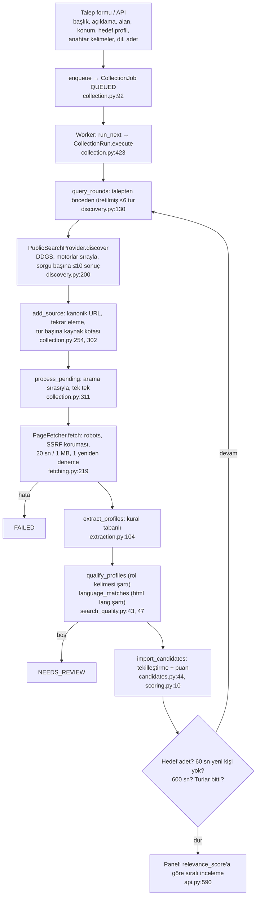
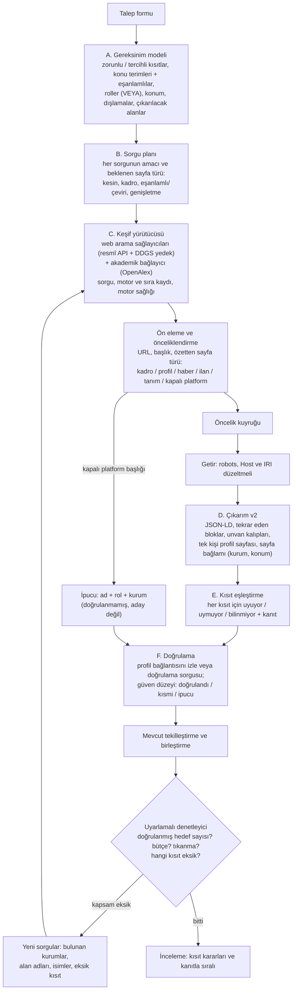

# Arama otomasyonu denetimi ve yeniden tasarım önerisi

Tarih: 11 Ekim 2026 (analiz); uygulama durumu 13 ve 24 Ekim 2026. Kapsam: `backend/app/services/`
altındaki arama hattı (keşif, getirme, çıkarım, eleme, içe aktarma, puanlama). Bölüm 1–8 11 Ekim'deki
analizdir; yapılanlar ve ölçümler "Uygulama durumu" bölümlerindedir.

Etiketler: **[DOĞRULANDI]** kod, veri, günlük veya canlı deneyle gösterildi. **[HİPOTEZ]** makul ama
ölçülmedi; nasıl test edileceği yazılı.

## 0. Yöntem ve kanıt kaynakları

| Kaynak | Ne yapıldı |
| --- | --- |
| Kod | `discovery.py`, `collection.py`, `fetching.py`, `extraction.py`, `search_quality.py`, `scoring.py`, `deduplication.py`, `candidates.py`, `config.py`, `models.py`, `api.py` satır satır okundu. |
| Veritabanı | Gerçek veritabanında **yalnızca okuma** (`BEGIN READ ONLY`): 10 talep, 17 toplama işi, 240 kaynak, 40 aday (9'u kurgusal test verisi). |
| Günlükler | Worker günlüklerindeki `source.error` iz kayıtları ve son işin zaman çizelgesi. |
| Canlı denemeler | Worker kapsayıcısında, veritabanına dokunmadan: 7 arama motoru × 3 sorgu, 11 sitenin robots.txt'si, yönlendirme zincirleri, 15 gerçek kişi listesi sayfasında çıkarım ölçümü. Sayfalar karşılaştırma için donduruldu. |

## 1. Yönetici özeti

Sorun anahtar kelimelerde değil. Arama hattı, her aşamada adayların çoğunu kaybeden bir huni:

```
240 keşfedilen kaynak
 ├─ 91 getirilemedi (%38)  ← 19'u iki kod hatası, 37'si zaten hiç izin vermeyen platformlar
 ├─ 107 okundu ama kişi çıkmadı (%45)  ← çıkarım, listelenen kişilerin ~%7'sini yakalıyor
 ├─ 24 gerek kalmadı / atlandı
 └─ 18 kaynak kişi verdi (%7,5) → 31 gerçek aday → 0'ı insan tarafından incelendi
```

En önemli bulgular:

1. **İki getirme hatası** [DOĞRULANDI]
   - HTTPS isteklerinde `Host` başlığı `alan:443` gidiyor. Bazı sunucular buna kendine yönlendirme döngüsü, 404 veya 503 ile cevap veriyor. Etkilenen 13 kaynak arasında Marmara Üniversitesi'nin kadro sayfası da var.
   - Türkçe karakterli adresler her seferinde `UnicodeEncodeError` ile çöküyor: robots kuralının izin verdiği 6 URL'nin 6'sı.
2. **Çıkarım kişi listelerini okuyamıyor** [DOĞRULANDI]
   - kişi içeren 13 gerçek sayfada (12 kadro/ekip listesi + 1 Wikipedia kişi maddesi) listelenen yaklaşık 270 kişinin 20'si çıkarıldı (%7). Sayfaların 11'inden tek kişi çıkmadı.
   - Kesinlik yüksek: 21 çıkarımdan 20'si doğru. Sistem fazla temkinli, fazla hatalı değil.
3. **Doğru sonucu sessizce atan filtreler** [DOĞRULANDI]
   - JSON-LD'de "Organization" olan her sayfa kişisiz sayılıyor. WordPress SEO eklentileri bunu her sayfaya ekliyor.
   - Dil filtresi `<html lang>` etiketine bakıyor. Türkçe içerikli siteler ve İstanbul üniversitelerinin İngilizce kadro sayfaları `lang="en"` bildiriyor, bu yüzden Türkçe taleplerde eleniyor.
   - Unvanı yazılmamış kişiler "rol uymuyor" sayılıyor.
4. **Sorgular niyeti değil kalıbı ifade ediyor** [DOĞRULANDI]
   - Sorgular "alan + şehir + rol + sabit ek" (biyografi/konuşmacı/kimdir/ekip) biçiminde kuruluyor.
   - Kullanıcının en ayırt edici terimleri (anahtar kelimeler) 5. tura kalıyor. Son işte o tura hiç gelinmedi.
   - Son işin 40 kaynağının yaklaşık yarısı ilgisiz: "CTO kimdir?" tanım yazıları, konuşmacı ajansları, adında "teknoloji" geçen servis firmaları.
5. **Arama altyapısı kırılgan** [DOĞRULANDI]
   - Tek kaynak, resmî olmayan bir kazıyıcı kütüphane (DDGS).
   - Bugün 7 motordan yalnız ikisi sonuç verdi. İngilizce bir sorgu tüm motorlarda boş döndü. Son işte 12 sorgunun 4'ü boştu.
6. **Ölçüm yok** [DOĞRULANDI]
   - Hiçbir aday incelenmemiş, gerçek sorgularla kurulmuş bir test seti yok, kaynakların hangi sorgudan geldiği kaydedilmiyor.
   - Bu yüzden bugün "doğru sonuç oranı" hesaplanamıyor. Yapılabilen ölçümler aşağıda.
7. **Konum hiç doğrulanmıyor** [DOĞRULANDI]
   - 31 gerçek adayın hiçbirinde kurum veya konum alanı dolu değil.
   - "İstanbul" talebine Missouri'deki bir akademisyen girmiş.

Öneri: önce dört küçük, test edilebilir P0 düzeltmesi (getirme hataları, iki filtre) ve ölçüm temeli. Ardından çıkarımı (tekrar eden blok tespiti) ve sorgu planlamasını yeniden kurmak. Gömme vektörleri (embeddings), yeniden sıralayıcı (reranker) ve hibrit arama bu aşamada gerekmiyor (bkz. bölüm 5).

## Uygulama durumu (11 Ekim 2026, 1. adım)

Kullanıcı kararları: ücretli arama API'si yok; konum ve dil **tercihli** (eleme yapmaz);
LinkedIn gibi platformlar da aransın.

| Görev | Durum | Not |
| --- | --- | --- |
| P0-1 Host başlığında `:443` | Yapıldı | `fetching.PinnedHTTP` |
| P0-2 ASCII dışı URL | Yapıldı | `fetching.ascii_url`; hatalı URL artık `FetchError` |
| P0-3 Organization kapısı | Yapıldı | Yalnızca sayfanın kurum olarak bildirdiği ad elenir. Ayrıca "…lerimiz" başlık koruması eklendi (PR2). |
| P0-4 Dil filtresi | Yapıldı | Not olarak kalıyor, eleme yapmıyor. |
| P0-5 Ek arama sağlayıcısı | Ertelendi | Ücretsiz kalma kararı. Boş sorgular artık `search_empty` sayacında. |
| P0-6 Ölçüm | Kısmen | D1 sayfa seti + `scripts/eval_extraction.py`. Kaynak başına sorgu/motor kaydı (şema değişikliği) yapılmadı. |
| QG2 Anahtar kelimeler ilk turda | Yapıldı | `query_rounds` |
| P1-4/P1-5 (kısmi) Platform ipuçları | Yapıldı | `services/platforms.py`. Ayrıntılar aşağıda. |

**Platform ipuçları nasıl çalışıyor:**
- LinkedIn, ResearchGate, Crunchbase, F6S ve The Official Board sayfaları hiç açılmaz. Google Scholar ve sosyal ağlar da açılmaz.
- Arama sonucunun başlığından ad, rol, kurum ve (varsa) konum alınır.
- Kayıt "Platform ipucu · doğrulanmadı" olarak işaretlenir; güven puanı en fazla 15'tir.
- İpuçları istenen adet kadarla sınırlıdır ve hedefi doldurmaz: arama sayfa kanıtlı kişiler için sürer.
- 2. tur `linkedin …` sorgularıdır; akademik taleplerde `researchgate …` da eklenir.

**Ölçümler:**

| Ölçüt | Önce | Sonra | Nasıl |
| --- | --- | --- | --- |
| D1 çıkarım: doğru kişi / listelenen | 20/280 (%7,1) | 22/280 (%7,9) | `eval_extraction.py`; "önce" eski kodun çalışan kapsayıcısında aynı sayfalarla |
| D1 yanlış kişi | 1 ("Kurucu Üyelerimiz") | 0 | aynı |
| D1 kişi çıkan sayfa | 2/13 | 4/13 | aynı |
| Testler | 217 | 248 (SQLite) / 247 (PostgreSQL, postal-kod testi öncesi) | `pytest` |

**Canlı denemeler** (yalıtılmış kopya, gerçek web, 11 Ekim):

| Talep | Önce | Sonra |
| --- | --- | --- |
| Yapay zekâ girişim kurucuları (tr, 10) | 1 kişi (gerçek sistemde, 79 sn) | 7 aday / 80 sn: 3 LinkedIn ipucu (CTO/kurucu), 4 sayfa kanıtlı (Selçuk Bayraktar, Soner Canko, Vehbi Emiroğlu, Steve Jobs) |
| Hacathlon (tr, 10) | 0 → 1 (10 Ekim) | 9 aday / 90 sn: 2 ipucu, 7 sayfa kanıtlı |
| Kontrol: İstanbul bilgisayarlı görü (en, 5) | 4 kişi / 39 sn, 5. turda | **COMPLETED**: 9 aday / 19 sn, 1. turda (5 sayfa kanıtlı + 4 ipucu) |

**Görülen kalite sorunu: konum doğrulanmıyor (PR1, P1-2).** Sayfa kanıtlı adaylarda konum çıkarılmadığı için yanlış şehirden kişiler elenmiyor; yalnız puanları düşük kalıyor.
- Hacathlon: 9 adayın 6'sı İzmir Yüksek Teknoloji Enstitüsü'nden.
- Kurucu araması: Steve Jobs (Wikipedia).
- Görüntü işleme: Konya'daki bir konferansın konuşmacısı.

Konumu bilinen platform ipuçları +20 konum puanıyla listenin üstüne çıkıyor.

**Arama motoru kararsızlığı sürüyor:** Hacathlon'da 19 sorgunun 9'u boş döndü (yahoo aralıklı).

**13 Ekim 2026 – hedefe kadar arama (kullanıcı kararı):**
- Son iki gerçek iş, 10 kişi hedefine karşı 1 ve 4 kişiyle 79 ve 125 sn sonra durdu. Sebep "60 sn yeni kişi yok" kuralıydı; 7 turdan yalnızca 4'ü denenmişti.
- Bu kural kaldırıldı. Arama artık hedef dolunca, kullanıcı durdurunca, yeni kaynak kalmayınca, 500 kaynak dolunca veya 60 dk güvenlik tavanında biter.
- Turlar bittiğinde, hâlâ yeni kaynak getiren sorgular için 2.–5. sonuç sayfaları da aranır.
- Turlar arasındaki kaynak payı kaldırıldı. Eskiden 1. tur 40 sonuçtan yalnız 9'unu alabiliyordu.
- Çıkarım oranı (D1'de %8) değişmedi. Daha uzun arama yalnızca daha çok sayfa okur.

**Sıradaki en büyük kazanç:**
- P1-1: siteden bağımsız kişi listesi çıkarımı (D1'de 22/280).
- P1-2: sayfa bağlamından kurum ve konum çıkarımı, ardından konum uyumu.

## Uygulama durumu (24 Ekim 2026, 2. adım: hattın yeniden kurulması)

Bu adımda P1-1…P1-6'nın tamamı ve P0-6'nın kalanı uygulandı. Kullanıcı kararları geçerlidir: ücretsiz arama, konum ve dil tercihtir, platformlar okunmaz.

| Görev | Durum | Nerede |
| --- | --- | --- |
| P1-1 Çıkarım v2 | Yapıldı | `record_blocks.py`: tekrar eden kayıt blokları, unvanlar ("Prof. Dr.", "Dr. Öğr. Üyesi", "ARAŞ. GÖR.", "Assoc. Prof.", "د."), "Rol: Ad", "Ad – Rol", "Soyad, Ad", hCard. Kişinin rolü, uzmanlığı, profil bağlantısı ve herkese açık e-postası yalnızca kendi bloğundan alınır. `mentions.py`: haberde unvan/rol ile anılan kişiler. |
| P1-2 Gereksinim modeli ve kısıt kararları | Yapıldı | `requirements.py`, `matching.py`. Rol, konu ve konum için ayrı karar (uyuyor / çıkarıldı / bilinmiyor / uymuyor) ve dayanağı (`candidates.match_details`). Puan bu kararların toplamıdır ve gerekçede "(+N)" olarak görünür. |
| Sayfa bağlamı | Yapıldı | `page_context.py`: kurum (başlık, og:site_name, JSON-LD) ve konum (adres/altbilgi, kurum adı, alan adı uzantısı). Kişiye "sayfadan çıkarıldı" notuyla yazılır. |
| P1-3 Amaçlı sorgu planı | Yapıldı | Kadro, ekip, konuşmacı ve jüri listeleri; ilk anahtar kelime 1. turda; ikinci dilde terim karşılıkları ve eşanlamlılar (`topics.py`, 6 dil); etkinlik konuşmacıları. "kimdir" ve "biyografi" ekleri kaldırıldı. Arapçada alan ve şehir de çevrilir. Otomatik dilde Türkiye'deki şehir `tr-tr` bölgesiyle aranır. |
| P1-4 Ön eleme ve öncelik | Yapıldı | `triage.py`. İş ilanı, tanım yazısı, PDF ve ürün sayfası açılmadan "Ön eleme" notuyla atlanır. Kaynaklar öncelik sırasıyla okunur. |
| P1-6 Uyarlamalı yürütme (sınırlı) | Yapıldı | Kişi çıkmayan ilgili bir sayfadan aynı sitenin ekip/kadro sayfasına geçilir (sayfa başına 3, iş başına `COLLECTION_MAX_FOLLOWED_LINKS`). Sayfadaki kişiler içe aktarmadan önce sıralanır. |
| Hedef sayımı | Yapıldı | Hedefe yalnızca rolü uyan, konumu çelişmeyen ve konu kanıtı olan kişiler sayılır. Konu kanıtı geniş alanlarda ("teknoloji") ve şef/doktor taleplerinde aranmaz. Başka konumdakiler ("Konum farklı") ve konusu doğrulanmayanlar listelenir, her biri istenen adet kadarla sınırlıdır. |
| P0-6 Kaynak kaydı | Yapıldı | `source_documents.query/engine/rank/page_kind/priority` (göç `20261024_search_provenance`, yalnızca ekleme). |
| Arama motoru kararsızlığı | İyileştirildi | Tüm motorlar boş dönerse bekleyip bir kez daha sorulur. 1. sayfa sorguları arasına 1 sn konur (`SEARCH_QUERY_INTERVAL_SECONDS`). |
| Sayfa boyutu | Değişti | `FETCH_MAX_BYTES` 1 → 3 MiB. Örneklenen 30 liste sayfasının 2'si 1 MiB'ı aşıyordu. |
| P1-5 İpucu doğrulama sorgusu, P1-7 OpenAlex | Yapılmadı | Bir sonraki adım. |

**Çıkarım ölçümü** (`scripts/eval_extraction.py`; kişi bazında duyarlılık / kesinlik):

| Set | Eski kod | Yeni kod | Not |
| --- | --- | --- | --- |
| D1: 13 sayfa, geliştirme seti | 22/280 (%7,9) / %100 | 285/285 / %100 | Bu sette ayar yapıldı, iyimserdir. 5 etiket eksiği düzeltildi (`labels.json` → `corrections`). |
| D1b: 27 sayfa, `heldout/` | 4/633 (%0,6) | 646/655 (%98,6) / %99,4 | Tasarımda kullanılmamak üzere toplandı, ama geliştirme sırasında birkaç kez ölçüldü. Bu yüzden iyimserdir. Etiket eksikleri `corrections` altında. |
| **D1c: 28 sayfa, `fresh/`, kör ilk ölçüm** | 2/601 (%0,3) | **392/601 (%65,2) / %93,1** | Çıkarım bittikten sonra toplandı ve kodu çalıştırmadan etiketlendi. **Genelleme için güvenilir sayı budur.** |
| D1c, düzeltmelerden sonra | — | 561/633 (%88,6) / %99,5 | Bu setten öğrenilen iki hata düzeltildi: `aside` içindeki sayfa gövdesinin silinmesi ve iki `span`'a bölünmüş hCard adları. Etiket eksikleri de tamamlandı. Artık kör değildir. |

Okunamayan sayfa türleri:
- JavaScript ile çizilen kadro sayfaları (YTÜ, Teknopark İstanbul),
- bot doğrulaması isteyen siteler (İÜC),
- adları yalnızca görselde olan sayfalar,
- adları parçalara bölen Google Sites sayfaları (kısmen).

**Canlı uçtan uca karşılaştırma** (`scripts/eval_search.py`, gerçek web, geçici SQLite, 10 kişi, 7 dk tavan, eski ve yeni sürüm aynı gün art arda):

| Talep | Eski: durum, süre, sorgu (boş), aday | Yeni: durum, süre, sorgu (boş), aday | Okuyarak değerlendirme (benim etiketim, kullanıcı etiketi değil) |
| --- | --- | --- | --- |
| 1. İstanbul bilgisayarlı görü akademisyenleri | PARTIAL, 141 sn, 21 (4), 12 | PARTIAL, 177 sn, 8 (1), 30 (10'u başka şehirde) | Eski ilk 10'da alanı doğrulanabilen 1 kişi var, 3'ü sosyal bilimci, 1'i "Bilgisayarlı Görü" başlığı. Yeni ilk 10'da 6 bilgisayarlı görü uzmanı var (İTÜ: Gözde Ünal, Hazım Ekenel, Muhittin Gökmen, Mustafa Kamaşak, Yusuf Yaslan, Damien Jade Duff). Bu koşudaki "Bilgisayarlı Görü" hatası sonradan düzeltildi. |
| 2. Yapay zekâ girişim kurucuları | PARTIAL, 284 sn, 48 (16), 18 (10 ipucu) | PARTIAL, 160 sn, 11 (1), 19 (5 ipucu) | Eskide adayların çoğu LinkedIn ipucu. Yenide AIGAP, Anemo ve Teknoloji Liderleri Zirvesi konuşmacıları (CTO/kurucu) var. Bu koşudaki "Convertible Note" ve "TFI TAB Gıda Yatırımları" hataları düzeltildi. Son kodla tekrar: 163 sn, 11 sorgu, 12 aday (Teknoloji Liderleri Zirvesi CTO'ları, ITS Istanbul 2026'nın yapay zekâ kurucuları); şirket adı hatası yok. |
| 3. Computer Vision Experts (konuşmacı, otomatik dil) | PARTIAL, 93 sn, 10 (2), 16 | COMPLETED, 9 sn, 4 (0), 10 | Yeni sürüm bu koşuda zayıftı: başlığında "yapay zeka" geçen bir kurs sayfasının yorumcuları hedefe sayıldı. Düzeltildi: rol şartı olmayan taleplerde konu kişinin kendi kaydında geçmelidir. Son kodla tekrar: COMPLETED, 13 sn, 4 sorgu. EYZ İstanbul (Eğitimde Yapay Zekâ Zirvesi) ve Webrazzi Summit konuşmacıları geldi; bunlar yapay zekâ konuşmacıları, bilgisayarlı görüye özel değil. |
| 4. Gastronomi şefleri | PARTIAL, 92 sn, 14 (9), 8 | COMPLETED, 18 sn, 3 (0), 10 | Yenide gastronomimerkezi.com şefler listesinden 9 şef var. Eskide LinkedIn ipuçları ve Vikipedi sayfaları. |
| 5. Veri bilimi profesörleri (Arapça) | NO_RESULTS, 165 sn, 22 (9), 0 | PARTIAL, 124 sn, 7 (0), 30 (10'u başka ülkede) | Yenide Bilgi Üniversitesi veri bilimi programının öğretim üyeleri var. Suudi üniversite kadroları "Konum farklı" olarak ayrıldı. |
| 6. Fintech yöneticileri | PARTIAL, 239 sn, 37 (13), 11 (9 ipucu) | PARTIAL, 62 sn, 7 (0), 12 (1 ipucu) | Yenide FinTech İstanbul kurucuları ve Istanbul Fintech Week konuşmacıları var. Eskide soyadı "Kurucu" olan iki yazılımcı "kurucu" sanılmıştı. |

Toplamda boş sorgu oranı 53/152'den (%35) 2/40'a (%5) düştü. Bu, tek günlük bir canlı karşılaştırmadır; arama motorlarının günlük değişkenliği sonucu etkiler. Kesinlik için insan etiketi (D3) hâlâ yoktur. Yukarıdaki değerlendirme benim okumamdır.

**Doğrulama:**
- 341 test SQLite'ta ve geçici PostgreSQL'de geçti; ruff temiz.
- Göç PostgreSQL'de mevcut satırla yükseltme, geri alma ve yeniden yükseltme ile denendi; `alembic check` temiz. SQLite'ta CHECK kısıtları korunuyor.
- `e2e_collection.py` geçti. Betiğin sahte sağlayıcısı 13 Ekim'deki sayfalama değişikliğinden beri bozuktu; düzeltildi.
- İzole Docker kurulumunda (`-p rip-verify`) `production_check.py --live --restart-worker` 25/25 ve `panel_smoke.py` geçti.

**Dağıtım:** gerçek kurulum (`relationship-intelligence`) yaklaşık 15 Ekim'den beri durdurulmuştu. 24 Ekim'de kullanıcının isteğiyle yedek alınıp (doğrulandı) yeni sürümle başlatıldı; göç uygulandı ve 105 aday yeniden puanlandı.

**Sıradaki:**
- P1-5: ipuçlarını doğrulama sorgusuyla sayfa kanıtına bağlamak.
- P1-7: akademik taleplerde OpenAlex.
- İnsan etiketleriyle (D3) Precision@10 ölçümü.
- Yeni bir kör sayfa seti (D1d).
- JavaScript ile çizilen sayfalar için isteğe bağlı tarayıcı adaptörü (P2-2).

## 2. Mevcut sistem: gerçek yürütme akışı



### Aşama aşama (bölüm 2'deki soruların cevapları)

**Girdiler sorguya nasıl dönüşüyor?**
- `search_intent` (`discovery.py:21`) alan, konum ve hedef rolü çıkarır.
- Hedef rol `requested_roles` (`search_quality.py:35`) ile 6 sabit rolden birine eşlenir: cto, founder, professor, chef, doctor, engineer.
- Açıklama ve notlar yalnızca rol tespiti için okunur.
- Anahtar kelimeler eski akışta ilk ikisiyle (`discovery.py:39`), tur planında 5. turda kullanılır (`discovery.py:155`).
- Talep başlığı sorgulara hiç girmez.

**Kaynak ve motor seçimi:**
- Tek sağlayıcı DDGS 9.16 metasearch. Motorlar `SEARCH_BACKENDS` sırasıyla tek tek denenir (`config.py:32`).
- Bölge dil seçimine göre belirlenir (`REGIONS`, `search_quality.py:8`). "Otomatik" dil `us-en` bölgesini kullanır.
- Akademik veya kurumsal yapılandırılmış kaynak yok.
- `services/search.py` yalnızca kurgusal demo verisi üretir; canlı akışta kullanılmaz.

**Anahtar kelimeler ve alternatif sorgular:**
- 6 strateji, en fazla 4'er sorgudan oluşan turlar halinde, sorgu tekrarı olmadan sırayla çalışır:
  1. birincil şablon
  2. yedek şablon
  3. alan parçaları × rol
  4. kadro sayfaları (+ Türkçe akademik taleplerde `site:edu.tr`)
  5. anahtar kelime × rol
  6. şehirsiz geniş sorgu
- Eşanlamlılar: 7 alanlık (`FIELDS`) ve 6 rollük (`TRANSLATIONS`) sabit sözlük.

**Çoklu arama:**
- Bir turun sorguları sırayla çalışır.
- Sonuçlar sorgular arasında sırayla dağıtılarak kaynak listesine eklenir. Her tur, toplam kaynak tavanının (60) bir payını alabilir.
- Turlar sonuçlara göre değişmez; plan baştan sabittir.

**Sonuçların alınması, normalleştirilmesi, saklanması:**
- URL kanonikleştirilir: parça ve izleme parametreleri silinir (`canonical_url`, `discovery.py:171`).
- Sayfa getirilir, SHA-256 ile aynı içerik elenir.
- Metin `SourceDocument.text` alanına yazılır (90 gün saklanır).
- Hangi sorgu, hangi motor ve kaçıncı sırada geldiği **kaydedilmez** (`models.py:195`).

**Değerlendirme ve sıralama:**
- Bir kişinin kabul edilmesi için sayfada aranan rolü gösteren bir kelime olmalı (`qualify_profiles`).
- `relevance_score` (`scoring.py:10`) şu puanların toplamıdır:
  - alan ifadesi metinde tam geçerse +25
  - anahtar kelimeler +30
  - konum +20
  - rol +10
  - kurum +5
  - biyografi +10
- Panelin varsayılan sıralaması bu puana göredir.
- Kaynaklar getirilmeden önce önceliklendirilmez.

**Eşanlamlılar ve dil farkları:**
- Karşılaştırmalar aksansız ve küçük harfli yapılır (`normalize`).
- Sorgular yazıldığı gibi gönderilir (yazım hataları dahil).
- Dil, getirilen sayfanın `<html lang>` etiketiyle zorunlu tutulur.

**Tekrarlar, ilgisiz ve erişilemeyen sayfalar:**
- URL ve içerik tekrarı iş içinde elenir.
- Kişi tekilleştirmesi talep bazında ve temkinlidir (`deduplication.py`). İyi çalışıyor; değişiklik önerilmiyor.
- İş ilanları başlık ve JSON-LD'den elenir.
- Erişilemeyen sayfa `FAILED` olur ama işi düşürmez.

**Limitler, zaman aşımları, yeniden denemeler:**
- Sorgu hatasında 2 yeniden deneme ve üstel bekleme uygulanır.
- Sayfa: 8 sn soket / 20 sn belge zaman aşımı, 1 MB, 1 yeniden deneme. robots crawl-delay > 10 sn ise sayfa atlanır.
- İş: 60 sn yeni kişi yoksa durur; tavan 600 sn ve 60 kaynak.

**Sınırlayıcı yapılandırma ve tasarım:**
- Sorgu başına sonuç sayısı 10 (yahoo pratikte 7 döndürüyor).
- Tur başına kaynak kotası.
- Seri getirme: aynı anda tek sayfa.
- Tasarım kararları bölüm 3'te.

## 3. Kök nedenler

Önem: **Kritik** = doğru sonucu engelliyor; **Yüksek** = sonuç kalitesini belirgin düşürüyor;
**Orta** = verim/maliyet. Öncelik bölüm 6'daki plana bağlıdır.

### 3.1 Query Generation (sorgu üretimi)

| # | Bulgu | Kanıt | Etki | Önem | Düzeltme |
| --- | --- | --- | --- | --- | --- |
| QG1 | Sorgular kalıp: `{alan} {şehir} {rol} {ek}`; ekler (biyografi, konuşmacı, kimdir, ekip) talepten bağımsız. "X kimdir" kalıbı rol kelimesiyle tanım yazısı getiriyor. [DOĞRULANDI] | `discovery.py:77-83`. Son iş (girişim kurucuları, 12 sorgu): 40 kaynağın el ile sınıflandırmasında ~20 ilgisiz ("CTO kimdir?", konuşmacı ajansları, teknopark ana sayfaları, adında "Teknoloji" geçen servis firmaları), 2 iş ilanı. | Okunan kaynakların yarısı boşa gidiyor; 60 sn kuralı gerçek sayfalara gelmeden durduruyor. | Yüksek | Amaçlı sorgu planı (bölüm 4-B); ekler yalnızca rol gerektiriyorsa. |
| QG2 | En ayırt edici terimler (anahtar kelimeler) son turlara bırakılıyor. [DOĞRULANDI] | `discovery.py:155` (5. strateji). Son işte 4. turdan sonra durma kuralı devreye girdi; "yapay zeka girisim" sorgusu hiç gönderilmedi; sonuçların hiçbiri yapay zekâya özgü değil. Bu sıra 10 Ekim'deki değişikliğimden geliyor. | Talebin asıl konusu aranmıyor. | Yüksek | Anahtar kelime ve konu terimleri ilk turda. |
| QG3 | Açıklama yalnızca rol için okunuyor; amaç/konu terimleri sorguya girmiyor. [DOĞRULANDI] | `requested_roles`, `search_intent`. Hackathon açıklaması ("mentorluk…") hiçbir sorguda yok. | Niyet kayboluyor. | Orta | Gereksinim modeli (4-A). |
| QG4 | "Akademisyen, işinde uzman" gibi çoklu rol tek role iniyor; "uzman/expert" rol sözlüğünde yok. [DOĞRULANDI] | `ROLES` (`search_quality.py:9`). | Sektör uzmanları hiç aranmıyor. | Orta | Rollerin VEYA ile birleşmesi; rol sözlüğünü genişletme. |

### 3.2 Search Strategy (arama stratejisi)

| # | Bulgu | Kanıt | Etki | Önem | Düzeltme |
| --- | --- | --- | --- | --- | --- |
| SS1 | Yalnız genel web araması; yapılandırılmış kaynak (akademisyenler için OpenAlex, şirket/kurucu için Wikidata) yok. [DOĞRULANDI] | Kod. | Akademik taleplerde en güvenilir kaynak kullanılmıyor. | Yüksek | Akademik bağlayıcı (P1-7). |
| SS2 | Uyarlamasız: plan baştan sabit; bulunan kadro sayfasının bağlantıları (profil, sayfalama) izlenmiyor; bulunan kurumlardan yeni sorgu üretilmiyor. [DOĞRULANDI] | `execute`, `collection.py:423-448`. | Bir kadro sayfası bulunduğunda bile kişilerin profil sayfalarına gidilmiyor. | Yüksek | Uyarlamalı denetleyici (4-C). |
| SS3 | Kaynaklar getirilmeden önce önceliklendirilmiyor; arama sırasıyla okunuyor. [DOĞRULANDI] | 240 kaynağın URL türüne göre verimi: kişi listesi URL'leri 70'te 10 (%14), "diğer" 98'de 3 (%3), kapalı platformlar 38'de 0. | Süre ve 60 sn penceresi düşük olasılıklı sayfalara harcanıyor. | Yüksek | Ön eleme ve öncelik kuyruğu (P1-4). |

### 3.3 Recall (yeterli sonuç gelmemesi)

| # | Bulgu | Kanıt | Etki | Önem | Düzeltme |
| --- | --- | --- | --- | --- | --- |
| RC1 | Sorgu başına en fazla ~7-10 sonuç; sorguların üçte biri boş. [DOĞRULANDI] | `collection.py:275` (`discover(query, 10)`); son işte 12 sorgu → 62 sonuç, 4 sorgu 0. | Aday havuzu baştan küçük. | Yüksek | Ek sağlayıcı (P0-5), daha çok amaçlı sorgu. |
| RC2 | Kapalı platform sonuçları kaynakların %16'sı (38/240); 37'si başarısız. Ama başlıkları ad+rol+kurum içeriyor ("Cihan Eker - Co-Founder and CTO @ Nimbu IT Services", "Gülşen Eryiğit - Professor of Artificial Intelligence…", "Taner CEVIK, Professor, Istanbul Rumeli University"). Bu bilgi atılıyor. [DOĞRULANDI] | `source_documents.title`. | Tam aranan kişiler kayboluyor. | Yüksek | Bu sonuçları getirmeden "ipucu" olarak tutup doğrulama sorgusu açmak (P1-5). Başlık tek başına kanıt sayılmaz. |

### 3.4 Precision (doğruluk)

| # | Bulgu | Kanıt | Etki | Önem | Düzeltme |
| --- | --- | --- | --- | --- | --- |
| PR1 | Konum ve kurum doğrulanmıyor. [DOĞRULANDI] | 31 gerçek adayın 31'inde konum/kurum boş. "İstanbul bilgisayarlı görü" talebinde engineering.missouri.edu kaynaklı aday. | Zorunlu kısıt kontrol edilmiyor. | Yüksek | Kısıt kararları (4-E) + sayfa bağlamından kurum/konum (P1-1). |
| PR2 | Liste başlığı kişi sanılıyor. [DOĞRULANDI] | teknolojidekadin.org'da "Kurucu Üyelerimiz" kişi olarak çıkarıldı ve rol filtresini geçti (bugünkü ölçüm, sayfa 14). | Sahte aday + 60 sn sayacını sıfırlıyor. | Orta | Başlık/çoğul-iyelik eki koruması; blok tabanlı çıkarım. |
| PR3 | Genel "kimdir" sorguları ünlü kişileri getiriyor. [HİPOTEZ] Getirme hataları düzelince Wikipedia sayfalarından ilgisiz ünlüler aday olabilir. | Son işte "kurucu kimdir" → Ekrem İmamoğlu (Wikipedia). Bugün getirilemediği için aday olmadı. | Düzeltmelerden sonra hatalı adaylar artabilir. | Orta | QG1 düzeltmesi + kısıt kararları. Test: P0 sonrası aynı talebi yeniden oynatmak. |

### 3.5 Ranking (sıralama)

| # | Bulgu | Kanıt | Etki | Önem | Düzeltme |
| --- | --- | --- | --- | --- | --- |
| RK1 | `relevance_score` ayırt edici değil: gerçek adaylarda 0-35. Alan eşleşmesi tam ifade arıyor ("AI and Math" hiçbir metinde geçmez); konum/kurum boş olduğu için +20/+5 hiç gelmiyor. Panel varsayılan olarak bu puana göre sıralıyor. [DOĞRULANDI] | `scoring.py:28`, `api.py:590`; veritabanı. | Doğru adaylar listenin üstüne çıkmıyor. | Orta | Kısıt kararlarına dayalı puan (P1-2). |

### 3.6 Filtering (doğru sonucu eleyen filtreler)

| # | Bulgu | Kanıt | Etki | Önem | Düzeltme |
| --- | --- | --- | --- | --- | --- |
| FL1 | JSON-LD'de "Organization" var ve "Person" yoksa sayfanın tamamı kişisiz sayılıyor. [DOĞRULANDI] | `extraction.py:127`. 15 sayfalık örnekte 3 sayfa bu yüzden boş: fintechistanbul.org/ekip, akademiktr.com, tr.wikipedia.org/Selçuk_Bayraktar. | WordPress ekip sayfaları ve Wikipedia kişi sayfaları toptan kayboluyor. | Kritik | Bu kapıyı kaldırmak; iş ilanı kapısı kalır (P0-3). |
| FL2 | Dil, `<html lang>` ile zorunlu tutuluyor. [DOĞRULANDI] Türkçe içerikli fintechistanbul.org `lang="en"`; Boğaziçi, İTÜ, Bilgi, Marmara İngilizce kadro sayfaları `lang="en"`. Türkçe talepte hepsi elenir. | `search_quality.py:47`, `collection.py:347`; sayfa etiketleri. Şimdiye kadar 1 kaynak bu nedenle elendi, çünkü işlerin çoğu "otomatik" dildeydi. | Türkçe taleplerde İstanbul kadroları görünmez. [HİPOTEZ: etki büyüklüğü D2 setinde ölçülecek] | Kritik | Dil zorunlu filtre değil sıralama sinyali olsun (P0-4, davranış değişikliği). |
| FL3 | Rol kanıtı olmayan kişi "uymuyor" sayılıyor. Sayfa bağlamı ("Academic Staff" başlığı) dikkate alınmıyor. [DOĞRULANDI] | `qualify_profiles`. bilgi.edu.tr Academic Staff sayfasında 6 kişiden 2'si unvanı yazılmadığı için elendi. | "Bilinmiyor" ile "uymuyor" karışıyor. | Yüksek | Üç durumlu karar: uyuyor / uymuyor / bilinmiyor; sayfa bağlamından rol çıkarımı (P1-2). |

### 3.7 Data Extraction (veri çıkarımı)

| # | Bulgu | Kanıt | Etki | Önem | Düzeltme |
| --- | --- | --- | --- | --- | --- |
| DE1 | Liste çıkarımı 3 sabit sınıf adına (`.team-member`, `.faculty-member`, `.staff-member`) ve `.profile-name`'e bağlı. Gerçek sitelerde başka adlar var: `faculty-name`, `card`, `boun-person-name`, `person-card`, `tcr-teammember-*`. [DOĞRULANDI] | `extraction.py:140, 163`. Ölçüm (bölüm 7.3): kişi içeren 13 sayfa (12 liste + 1 kişi maddesi), ~270 kişi → 20 doğru çıkarım (%7); 11 sayfadan hiç kimse. | Ana kayıp noktası. | Kritik | Siteden bağımsız tekrar eden blok tespiti + unvan kalıpları (P1-1). |
| DE2 | Düz metin kalıpları desteklenmiyor. Örnekler: "Serhat ÖZEKES Prof. Dr." (Marmara), "Prof. Dr. Jale Çakıroğlu" (ODTÜ), "Prof. Dr. Selim YAZICI – Kurucu Ortak" (FinTech İstanbul), "Tolunay Yıldız Yönetim Kurulu Başkanı, CEO" (YEO). [DOĞRULANDI] | Donmuş sayfa metinleri. | Aynı. | Kritik | Aynı. |
| DE3 | Rol sözlüğünde CEO, Genel Müdür, Yönetim Kurulu Başkanı, Öğretim Görevlisi, Lecturer, Faculty Member yok ya da eksik. [DOĞRULANDI] | `ROLES`. | Kurucu/yönetici ve akademik unvanlar kaçıyor. | Yüksek | Sözlük genişletme; testli. |
| DE4 | Kurum ve konum çıkarılmıyor: sayfanın sahibi kurum ve adresi sayfada olduğu halde alanlar boş. [DOĞRULANDI] | Veritabanı (31/31 boş). | Konum doğrulanamıyor, puan anlamsız. | Yüksek | Sayfa bağlamı: site adı, `<title>`, adres/footer, alan adı → kurum (P1-1). |
| DE5 | JavaScript ile çizilen sayfalar boş geliyor. [DOĞRULANDI] Örnekler: itu.edu.tr/en/faculty-list (yalnız menü, 1.684 karakter), bbf.itu.edu.tr staff, teknoparkistanbul.com.tr/ekip. Payı [HİPOTEZ: tahminen %5-10]. | `SourceDocument.text`. | Bazı büyük kadrolar okunamıyor. | Orta | Ölçtükten sonra isteğe bağlı tarayıcı adaptörü (P2-2). |

### 3.8 Language and Semantic (dil ve anlam)

| # | Bulgu | Kanıt | Etki | Önem | Düzeltme |
| --- | --- | --- | --- | --- | --- |
| LS1 | Eşanlamlı sözlüğü 7 alanla sınırlı. "görüntü işleme" ≈ "computer vision", "girişim" ≈ "startup", "fintech", "doğal dil işleme" ≈ "NLP" yok. [DOĞRULANDI] | `FIELDS` (`discovery.py:100`). | Aynı kavramın diğer adı aranmıyor. | Orta | Konu sözlüğü (TR/EN), sınırlı ve testli. |
| LS2 | Yazım hataları ve karışık dil olduğu gibi sorguya gidiyor ("Hacathlon", "Theore", "LIve app", "kuruclari"). [DOĞRULANDI] | Talep kayıtları. | Zayıf sorgular. | Düşük | Gereksinim modelinde temizleme; isteğe bağlı dil modeli (P2-1). |
| LS3 | "Otomatik" dil `us-en` bölgesi kullanıyor; Türkçe şehirli taleplerde ABD sonuçları gelebilir. [DOĞRULANDI kodda; etki HİPOTEZ] | `REGIONS['auto']`. | Yerel sonuçlar azalabilir. | Düşük | Bölgeyi konumdan türetmek; D2 setinde ölçmek. |

### 3.9 Infrastructure and API (altyapı)

| # | Bulgu | Kanıt | Etki | Önem | Düzeltme |
| --- | --- | --- | --- | --- | --- |
| IN1 | HTTPS isteğinde `Host: alan:443` gönderiliyor (`PinnedHTTP`, `http.client.HTTPConnection`'dan türüyor; varsayılan port 80). [DOĞRULANDI] | `fetching.py:67`. Aynı URL: mevcut indirici "Too many redirects"/404/503; yalnızca Host başlığı farklı istek 200. Etkilenen 13 kaynak: 7 yönlendirme döngüsü (5'i bugün yeniden üretildi), Marmara kadro sayfası 404 (4 kayıt), Bilkent 503 (2 kayıt). | Önemli kadro sayfaları hiç okunmuyor. | Kritik | Portu şemaya göre ayarlamak (P0-1). |
| IN2 | ASCII dışı URL → `UnicodeEncodeError`; yakalanmıyor, "Kaynak okunamadı" diye raporlanıyor. [DOĞRULANDI] | `fetching.py:123`, `collection.py:389`; günlükteki iz kaydı. robots'un izin verdiği 6 ASCII dışı URL'nin 6'sı çöktü (Wikipedia kişi sayfaları, Indeed). | Türkçe adresli sayfalar hiç okunmuyor. | Kritik | IRI→URI dönüşümü + hatayı `FetchError` yapmak (P0-2). |
| IN3 | Arama tek bir resmî olmayan kazıyıcıya bağlı. [DOĞRULANDI] | Bugün 7 motor × 3 sorgu: yahoo 2/3, duckduckgo 1/3, diğer 5 motor 0/3. "computer vision Istanbul faculty members" hiçbir motorda sonuç vermedi. Dün yalnız yahoo cevap veriyordu. | Arama her an tamamen boş dönebilir. | Kritik | Resmî arama API'si bağdaştırıcısı + motor sağlık kaydı (P0-5, karar gerekir). |
| IN4 | Bazı siteler bot User-Agent'ına özel engel uyguluyor. Boğaziçi robots.txt bota 500, tarayıcıya 200 dönüyor; ensun.io 429. Mevcut davranış (robots alınamazsa sayfayı getirmemek) RFC 9309 ile uyumlu. [DOĞRULANDI] | Canlı deneme. | Bu siteler okunamıyor. | Düşük | **Atlatma önerilmiyor.** İsteğe bağlı: UA'ya iletişim adresi eklemek (P2-3). |
| IN5 | vision.itu.edu.tr zaman aşımına uğruyor (sitenin kendisi). [DOĞRULANDI] | Canlı deneme. | — | — | Yok. |

### 3.10 Evaluation (ölçüm)

| # | Bulgu | Kanıt | Etki | Önem | Düzeltme |
| --- | --- | --- | --- | --- | --- |
| EV1 | İnsan etiketi yok: 31 gerçek adayın 0'ı onaylanmış veya reddedilmiş. [DOĞRULANDI] | Veritabanı. | Kesinlik ölçülemiyor. | Kritik | Etiketleme turu (bölüm 7). |
| EV2 | Testler kurgusal: 100 vakalık derlem kuralların regresyonunu ölçüyor, gerçek sayfa veya talep kalitesini değil. Canlı kontroller tek seferlik. [DOĞRULANDI] | `tests/fixtures/search_cases_100.json`, `docs/validation.md`. | İyileşme kanıtlanamıyor. | Yüksek | Donmuş gerçek sayfa ve talep setleri (P0-6). |
| EV3 | Kaynakların hangi sorgudan, hangi motordan, kaçıncı sırada geldiği kaydedilmiyor. [DOĞRULANDI] | `models.py:195`. | Sorgu başına verim hesaplanamıyor. | Yüksek | `SourceDocument`'a alanlar (P0-6). |

## 4. Önerilen mimari



### Aşamalar: gerekli mi, neden, mevcut koddan ne kalıyor?

| Aşama | Gerekli mi? | Gerekçe (kanıt) | Mevcut koddan |
| --- | --- | --- | --- |
| **A. Gereksinim modeli** | Evet, deterministik sürüm | QG2-QG4, FL3, PR1: zorunlu ve tercihli ayrımı yok, açıklama ve anahtar kelimeler kayboluyor. | `search_intent`, `requested_roles`, `split_fields`, `FIELDS` buraya taşınır. |
| **B. Sorgu planı** | Evet | QG1-QG2, RC1. Her sorgu bir amaçla etiketlenir; anahtar kelimeler ve konu ilk turda; "kimdir" yalnızca isim doğrulamada. | `query_rounds` yerine `plan_queries`; tur ve durma mekanizması korunur. |
| **C. Uyarlamalı yürütme** | Evet, sınırlı | SS2-SS3, RC2. Öncelik kuyruğu, ipucu → doğrulama sorgusu, kurum → ekip sayfası sorgusu, kadro sayfası → profil bağlantıları. Sorgu, kaynak ve süre bütçeleri; başarısız sorgu değişmeden tekrarlanmaz. | `CollectionRun`, kontrol noktaları, iptal, kaldığı yerden devam ve durma kuralları korunur. |
| **D. Toplama ve tekilleştirme** | Mevcut yeterli | Tekilleştirme temkinli ve doğru (aynı adlı farklı kişileri birleştirmiyor). | `deduplication.py` değişmez. |
| **E. Kısıt eşleştirme** | Evet | FL3, PR1, RK1. "Bilinmiyor" ≠ "uymuyor". Zorunlu kısıtta açık uyumsuzluk varsa aday gizlenip gerekçesiyle saklanır. | `qualify_profiles` ve `analyze` yeniden yazılır; API alan adları korunur. |
| **F. Doğrulama** | Evet | RC2, PR1. Arama özeti tek başına kanıt sayılmaz; özgün sayfa getirilir. Kaynak URL, çıkarılan alanlar, kanıt metni, güven düzeyi ve kabul/ret gerekçesi saklanır. | `CandidateSource.evidence` korunur; aday kaydına doğrulama düzeyi eklenir. |
| Dil modeli | Hayır, şimdilik değil | Deterministik çözüm ölçülmeden eklenmemeli; sayfa metni dış servise gider (kişisel veri). | `ai.py` sağlayıcı sınırı var; P2'de ölçümle denenebilir. |

### Kısıt varsayılanları (karar gerekir)

- **Rol:** zorunlu. Birden çok rol VEYA ile birleşir.
- **Alan/konu:** zorunlu ama "bilinmiyor" kabul edilir, puanı düşürür.
- **Konum:** önerim tercihli. Sayfalarda çoğunlukla açıkça yazmıyor; zorunlu yapılırsa sonuçların çoğu "bilinmiyor"a düşer.
- **Dil:** kaynak dili değil, sorgu dili.

Formda zorunlu/tercihli seçimi P2-6'da.

## 5. Alternatiflerin karşılaştırılması

| Seçenek | Hangi sorunu çözer? | Maliyet / karmaşıklık | Karar |
| --- | --- | --- | --- |
| Mevcut sorguları iyileştirmek | QG1-QG2 | Düşük | **Şimdi**, ama tek başına yetersiz: kayıpların çoğu getirme ve çıkarımda. |
| Amaçlı çoklu sorgu planı | QG, RC1 | Düşük-orta | **Şimdi** (P1-3). Mevcut tur yapısı üzerine kurulur. |
| Çoklu sağlayıcı (resmî arama API'si + DDGS) | IN3, RC1 | Orta; API anahtarı ve olası ücret | **Şimdi** (P0-5). Karar ve anahtar senden. Seçenekler: Brave Search API, Google Programmable Search JSON API, kendi sunucunda SearXNG. SearXNG de motorları kazıdığı için aynı engellenme riskini taşır. Bing Search API kapatıldı (Microsoft, Ağustos 2025). Fiyat ve kotalar seçimden önce doğrulanmalı. |
| Yapılandırılmış kaynaklar (OpenAlex, Wikidata) | SS1, PR1 (kurum ve konum yapılandırılmış gelir) | Orta; ücretsiz ve anahtarsız (koşullar doğrulanmalı) | **Akademik talepler için P1** (OpenAlex). Kurucu/şirket için Wikidata, P2'de denenir. |
| BM25 / sözcüksel puanlama | SS3 (ön eleme), RK1 | Düşük | **Hafif sürüm şimdi**: başlık ve özet için ağırlıklı terim eşleşmesi, kütüphane gerekmez. Tam BM25 dizini gerekmez, çünkü indekslenecek kalıcı bir derlem yok. |
| Gömme vektörleri (embeddings) | LS1 (anlamsal konu eşleşmesi) | Orta-yüksek (model veya ücretli API) | **Ölçümden sonra.** Eşanlamlı sözlüğü D2 setinde yetersiz kalırsa. |
| Hibrit arama | — | Yüksek | **Gerek yok.** Kendi dizinimiz yok; sonuçlar arama motorlarından geliyor. |
| Yeniden sıralayıcı (reranker) | RK1 | Orta-yüksek | **Gerek yok (şimdilik).** Aday kümesi küçük; sıralama sorunu algoritmadan değil kanıt alanlarının boş olmasından. |
| Dil modeliyle gereksinim anlama / sorgu planlama | QG3, LS2 | Çağrı başına ücret; gizlilik | **P2, ölçümle.** Deterministik model + D2 setiyle karşılaştırma; bayrakla, maliyet sınırıyla. |
| Dil modeliyle bloktan çıkarım | DE1-DE3 | Sayfa başına ücret; sayfa metni dış servise gider | **P2, ölçümle.** Önce kural tabanlı blok çıkarımı. |
| Başsız tarayıcı (Playwright) | DE5 | Yüksek (büyük bağımlılık, güvenlik yüzeyi) | **P2, payı ölçüldükten sonra.** |
| Engel atlatma (tarayıcı UA taklidi, robots'u yok saymak) | IN4 | — | **Önerilmiyor.** Projenin erişim politikasına aykırı. |

## 6. Uygulama planı

Mevcut API ve panel arayüzleri korunur. Her görev TDD ile yapılır; davranış değişikliği olan
görevler ayrıca işaretli.

### P0 — Kritik: aramanın doğru çalışmasını engelleyenler

| # | Dosya / fonksiyon | Değişiklik | Neden | Risk / bağımlılık | Doğrulama testi | Kabul ölçütü |
| --- | --- | --- | --- | --- | --- | --- |
| P0-1 | `fetching.py` `PinnedHTTP` | HTTPS bağlantısında `default_port = 443`; `Host` başlığı portsuz. | IN1 | Düşük; IP sabitleme ve SSRF korumaları aynı kalır. | Birim: gönderilen `Host` başlığında `:443` yok. Regresyon: kendine yönlendiren sahte sunucu. | 13 etkilenen URL'nin erişilebilir olanları canlıda 200; tüm testler yeşil. |
| P0-2 | `fetching.py` `fetch_public` (+ `discovery.canonical_url`) | IRI→URI: yol ve sorgu yüzde kodlanır (mevcut `%XX` korunur), alan adı IDNA; yönlendirme `Location` başlığı da. `UnicodeError` → `FetchError`. | IN2 | Düşük; kanonik anahtar değişirse aynı sayfa iki kez sayılabilir, test bunu yakalar. | Birim: "Selçuk_Bayraktar" yolu ve ASCII dışı `Location`; aynı sayfanın kodlu ve kodsuz hali tek kaynak. | Günlükte 0 `UnicodeEncodeError`; 6 geçmiş URL getiriliyor. |
| P0-3 | `extraction.py:127` | "Organization" kapısı kaldırılır; iş ilanı kapısı kalır. | FL1 | Orta: daha fazla sayfa çıkarıma girer, yanlış pozitif riski. | 100 vakalık derlem (kurum negatifleri dahil) yeşil kalır. Yoast benzeri Organization + ekip listesi sayfasından kişiler çıkar. | Derlem 100/100; 3 örnek sayfa kişi verir. |
| P0-4 | `collection.py:347`, `search_quality.language_matches` | Dil zorunlu filtre olmaktan çıkar; eşleşmeyen dil "dil farklı" notu ve sıralama sinyali olur. | FL2 | **Davranış değişikliği.** `test_mismatched_source_language_is_not_imported` güncellenir. Onayın gerekir. | Türkçe talep + `lang="en"` İstanbul kadro sayfası → kişiler gelir, işaretli. | D2 setinde Türkçe taleplerde "dil nedeniyle elendi" = 0. |
| P0-5 | `discovery.py` (yeni sağlayıcı sınıfı), `config.py`, `.env.example` | `DiscoveryProvider` arayüzüyle resmî bir arama API'si bağdaştırıcısı; DDGS yedek; motor başına başarı sayaçları `job.stats`'a. | IN3, RC1 | API anahtarı, olası ücret, kota. **Karar senden.** | Sahte HTTP ile birim testleri; anahtar yoksa DDGS'ye düşme. | D2 canlı koşusunda boş sorgu oranı < %10 (bugün %33). |
| P0-6 | `models.py` `SourceDocument` + Alembic göçü; `collection.add_source`; yeni `scripts/eval_*.py` | Kaynağa `query`, `engine`, `rank` alanları. Donmuş sayfa seti (D1) ve talep tekrar oynatma seti (D2) için değerlendirme betikleri. | EV2-EV3; sonraki her adımın ölçülebilmesi için | Göç gerçek veritabanına yalnız onayla ve yedekten sonra uygulanır. | Göç ileri-geri testi; değerlendirme betiği bugünkü taban değerleri yeniden üretir. | Bölüm 7.3'teki taban değerler betikle tekrar üretilebiliyor. |

### P1 — Yüksek etki: kesinlik ve kapsamı belirgin artıracaklar

| # | Dosya / fonksiyon | Değişiklik | Neden | Risk | Test | Kabul ölçütü |
| --- | --- | --- | --- | --- | --- | --- |
| P1-1 | `extraction.py` (yeni: `record_blocks`, `titled_names`, `page_context`); `search_quality.ROLES` | Çıkarım v2. Siteden bağımsız tekrar eden kardeş blok tespiti: aynı etiket/sınıf imzası, ≥3 blok, her birinde ad benzeri satır. TR/EN unvan kalıpları ("Prof. Dr. Ad SOYAD", "Ad SOYAD Prof. Dr."). Tek kişilik profil ve Wikipedia kişi sayfası. Sayfa bağlamından kurum ve konum. Başlık korumaları ("…lerimiz"). Kanıt, kişinin kendi bloğu. Rol sözlüğü: CEO, kurucu ortak, genel müdür, yönetim kurulu başkanı, öğretim görevlisi, lecturer… | DE1-DE4, PR2 | Orta: yanlış pozitif. Bu yüzden önce D1 ölçümü. | D1 setinde birim testleri (gerçek sayfa parçaları); 100 vakalık derlem. | D1: kişi bazında duyarlılık ≥ %70, kesinlik ≥ %90; bu 13 sayfanın ≥ 10'ü kişi verir. |
| P1-2 | Yeni `services/requirements.py`; `search_quality.qualify_profiles` → `match_constraints`; `scoring.analyze`; `models.Candidate` (+ `match_details` JSON, `verification_level`) + göç | Gereksinim modeli; kısıt başına uyuyor/uymuyor/bilinmiyor + kanıt. Sayfa bağlamından rol çıkarımı ("Academic Staff" → akademik, *çıkarsandı* notuyla). Puan bu kararlardan hesaplanır. Açık uyumsuzluklar gizlenir ama gerekçesiyle saklanır. | FL3, PR1, RK1, QG4 | Orta; API yanıtına yeni alanlar eklenir (geriye uyumlu). | Kısıt kararları için tablo testleri; mevcut iş akışı testleri. | D2'de gösterilen adayların zorunlu kısıt "uyuyor" oranı raporlanır; "uymuyor" olan hiçbir aday normal listede değil. |
| P1-3 | `discovery.py` `query_rounds` → `plan_queries`; konu sözlüğü | Amaçlı sorgular: (1) anahtar kelime/konu + rol + şehir; (2) kadro ve ekip sayfaları; (3) eşanlamlı ve çeviri; (4) genişletme. Talepten bağımsız ekler kaldırılır; "kimdir" yalnızca isim doğrulamada. | QG1-QG3, LS1 | Düşük-orta. | Plan testleri: anahtar kelime 1. turda; tekrar yok; her sorgunun amacı var. | D2: getirilen kaynaklarda kişi sayfası payı > %50 (bugün ~%29); P@10 artışı raporlanır. |
| P1-4 | Yeni `services/triage.py`; `collection.search` / `process_pending` | Sonuç ön elemesi (sayfa türü + terim eşleşmesi) ve öncelik kuyruğu. Kapalı platformlar hiç getirilmez. | SS3, RC2 | Düşük. | Sınıflandırma birim testleri; sıra testi. | Kapalı platform getirme denemesi = 0; ilk kişiye kadar geçen süre ↓ (D2). |
| P1-5 | `triage.py` (ipucu ayrıştırma), `collection.py` (doğrulama adımı) | Kapalı platform başlığından ipucu: "Ad - Rol - Kurum". Önce kadro sayfasındaki profil bağlantısı izlenir (aynı alan adı, sayfa başına ≤ N, robots). Yoksa doğrulama sorgusu "Ad Kurum". Doğrulama düzeyi: doğrulandı / kısmi / ipucu. | RC2, PR1, F | Orta; ek getirme ve sorgu bütçesi. | Bağlantı izleme sınırları; ipucu hiçbir zaman "doğrulandı" olmaz. | Özgün sayfa kanıtı olmadan "doğrulandı" aday = 0. |
| P1-6 | `collection.CollectionRun` (denetleyici) | Uyarlama: kurum → "kurum + ekip"; kişi veren alan adı → kardeş liste sayfaları; eksik kısıt → hedefli sorgu. Durma: hedef doğrulanmış kişi, bütçe (sorgu, getirme, süre), tıkanma. Kaldığı yerden devam korunur. | SS2 | Orta; bütçe aşımı → tavanlar. | Sahte sağlayıcı ve saatle deterministik testler (mevcut desen). | D2'de bütçe içinde havuzlanmış Recall@20 artışı. |
| P1-7 | Yeni `services/connectors/openalex.py` | Akademik taleplerde OpenAlex: kurumu şehirde olan + konusu eşleşen yazarlar → ipucu; doğrulama kurum sayfasından. | SS1, PR1 | Dış API koşulları; ad eşleşmesi belirsizliği. | Sahte yanıtla birim testleri. | Akademik D2 taleplerinde doğrulanmış kişi sayısı artışı. |

### P2 — İyileştirme: performans, maliyet, bakım

| # | Değişiklik | Neden | Kabul ölçütü |
| --- | --- | --- | --- |
| P2-1 | Dil modeliyle gereksinim ayrıştırma ve blok çıkarımı (bayrakla; maliyet sınırı; deterministik yedek). | LS2, QG3 | D1/D2'de deterministiğe göre anlamlı artış ve iş başına maliyet raporu; artış yoksa açılmaz. |
| P2-2 | JS ile çizilen sayfalar için isteğe bağlı tarayıcı adaptörü. | DE5 | Önce pay ölçülür; ≥ %10 ise ve kabul edilirse. |
| P2-3 | UA'ya iletişim adresi; robots önbelleği işler arası; alan adı istatistikleri. | IN4 | Engellenen sayfa oranı raporlanır; atlatma yok. |
| P2-4 | Haftalık canlı kanarya koşusu (D4) ve ölçüm özeti; motor sağlık komutu. | IN3, EV | Haftalık rapor üretiliyor. |
| P2-5 | İnsan etiketleriyle (≥ 100) puan ağırlıklarının ayarlanması. | RK1 | nDCG@10 artışı. |
| P2-6 | Formda kısıt başına zorunlu/tercihli seçimi; ret gerekçe kodları. | A, EV1 | Panel testleri. |
| P2-7 | Farklı sitelere paralel getirme (site başına nezaket korunarak). | Süre | Medyan iş süresi ↓, hata oranı değişmez. |

## 7. Değerlendirme planı

### 7.1 Veri setleri

| Set | İçerik | Nasıl toplanır |
| --- | --- | --- |
| **D1** donmuş sayfalar | 40-60 gerçek sayfanın HTML'i ve etiketi: sayfa türü; listelenen her kişi için ad, rol, kurum, şehir. | Bugün 15 sayfa donduruldu. Geçmişteki 240 kaynaktan türüne göre örneklenip tamamlanır. Gerçek kişi adları içerdiği için repoya değil, yerel ve git dışı bir klasöre (karar senin). |
| **D2** talep tekrar oynatma | 10 gerçek talep (bölüm 7.2). Her biri için arama sonuçları ve sayfa anlık görüntüleri saklanır. Eski ve yeni hat aynı girdiyle çevrimdışı ve deterministik çalışır. | Bir kez canlı toplama + kayıt. |
| **D3** ilgililik etiketleri | Her sürümün her talepteki ilk 20 adayı havuzlanır. Panelde Onayla = ilgili, Reddet = ilgisiz (+ not), ayrıca "bilinmiyor". | ~200 etiket, tahminen 1-2 saat insan emeği. |
| **D4** canlı kanarya | D2 talepleri haftada bir canlı çalışır; motor sağlığı ve süre izlenir. | P2-4. |

### 7.2 D2 talep seti (mevcut verilerden)

1. Canlı arama: İstanbul bilgisayarlı görü (Professor, otomatik dil)
2. İstanbul yapay zekâ konuşmacıları (Expert, akademisyen bağlamı)
3. chef yarışması (gastronomi, Türkiye)
4. teknoloji fuarı katılımcıları (CTO/kurucu, otomatik dil)
5. Hacathlon Etkinliği (AI and Math, Türkçe, akademisyen + uzman)
6. yapay zekâ girişim kurucuları (Türkçe)
7. Türkçe NLP uzmanları (test senaryosu)
8. Arapça konuşan AI araştırmacıları (test senaryosu)
9. Kontrol: İstanbul görüntü işleme akademisyenleri (İngilizce)
10. Durma testi: anlamsız talep (sıfır sonuç beklenir; yanlış pozitif ölçümü)

### 7.3 Bugün ölçülen taban değerler

| Ölçüt | Değer | Kaynak |
| --- | --- | --- |
| Kaynak getirme başarısızlığı | 91/240 = %38 (37 kapalı platform; 19 kod hatası; gerisi site engeli veya zaman aşımı) | Veritabanı, günlük |
| Okunup kişi vermeyen kaynak | 107/240 = %45 | Veritabanı |
| Kişi veren kaynak | 18/240 = %7,5 | Veritabanı |
| Çıkarım duyarlılığı (kişi listesi sayfaları) | ≈ 20/270 = %7. Sayfa başına: Sabancı 0/21, İTÜ Vision Lab 0/29, SPACING 0/22, Boğaziçi 0/52, İTÜ YZ 14/28, Bilgi 6/11, Marmara 0/33, ODTÜ 0/20, Teknopol 0/8, FinTech İst. 0/≥4, YEO 0/6, Teknolojide Kadın 0/35, Wikipedia 0/1 | Donmuş 15 sayfa; sayfaya özel seçicilerle yarı otomatik sayım (yaklaşık) |
| Çıkarım kesinliği | 20/21 = %95 (1 sahte: "Kurucu Üyelerimiz") | Aynı |
| En az bir kişi veren sayfa (13 sayfa) | 2/13 | Aynı |
| Çalışan arama motoru | 7 motordan 2'si (yahoo 2/3, duckduckgo 1/3 sorgu) | Canlı deneme |
| Boş sorgu oranı (son iş) | 4/12 | Günlük |
| İş süresi | 5-79 sn, medyan ~22 sn | `collection_jobs` |
| Talep başına sorgu / kaynak | 1-12 sorgu, 10-40 kaynak | `collection_jobs` |
| Konumu / kurumu doğrulanmış aday | 0/31 | Veritabanı |
| Precision@K, Recall@K, nDCG | **Ölçülemiyor**: 0 insan etiketi | — |

### 7.4 Ölçütler ve hedefler

| Ölçüt | Tanım | Hedef (öneri) |
| --- | --- | --- |
| Precision@10 | İlk 10 adayda D3'e göre ilgili olanların oranı | ≥ 0,6 |
| Havuzlanmış Recall@20 | İlk 20'de bulunan ilgililer / havuzdaki tüm ilgililer. Mutlak duyarlılık bilinemez; havuzlama yöntemi kullanılır. | Taban sürüme göre ≥ 2 kat |
| Başarı oranı | En az min(5, istenen adet) ilgili ve doğrulanmış aday bulunan talepler | ≥ 8/9 (anlamsız talep hariç) |
| Sıfır sonuç oranı | Hiç ilgili aday bulunamayan talepler | ≤ 1/9 |
| Zorunlu kısıt uyumu | Gösterilen adaylarda tüm zorunlu kısıtlar "uyuyor" olanların oranı | Raporlanır; "uymuyor" = 0 |
| Sıralama kalitesi | nDCG@10 (D3) | Taban sürüme göre artış |
| Süre | Medyan ve en kötü iş süresi | Medyan ≤ 3 dk, tavan 10 dk |
| Maliyet | Talep başına sorgu, getirme, (varsa) API ve dil modeli maliyeti | Talep başına ≤ 25 sorgu, ≤ 80 getirme |
| Getirme başarısızlığı (nedenine göre) | Politika / site / kod hatası | Kod hatası = 0 |
| Çıkarım duyarlılığı / kesinliği (D1) | Kişi bazında | ≥ %70 / ≥ %90 |
| Doğrulama başarısızlığı | İpucu veya listeden doğrulanamayanların oranı | Raporlanır |

**Karşılaştırma protokolü:** her P0/P1 adımından sonra D1 ve D2 çevrimdışı çalıştırılır. Değerler bu tabloya önceki/sonraki olarak eklenir. Bir değişiklik kesinliği düşürüyorsa birleştirilmez. Sonuç sayısı tek başına başarı ölçütü değildir.

## 8. Değiştirilecek dosya ve fonksiyonlar

| Dosya | Fonksiyon / sınıf | Görev |
| --- | --- | --- |
| `backend/app/services/fetching.py` | `PinnedHTTP`, `fetch_public` | P0-1, P0-2 |
| `backend/app/services/discovery.py` | `canonical_url`, `PublicSearchProvider`, yeni sağlayıcı, `query_rounds` → `plan_queries`, `FIELDS` | P0-2, P0-5, P1-3 |
| `backend/app/services/extraction.py` | `extract_profiles` (Organization kapısı), yeni `record_blocks` / `titled_names` / `page_context`, `person_name`, `STOP_WORDS` | P0-3, P1-1 |
| `backend/app/services/search_quality.py` | `language_matches`, `qualify_profiles` → `match_constraints`, `ROLES`, `TRANSLATIONS`, `REGIONS` | P0-4, P1-1, P1-2 |
| `backend/app/services/collection.py` | `process` (dil, ipucu, doğrulama), `search`, `process_pending` (öncelik kuyruğu), `execute` (uyarlama), `add_source` (sorgu/motor/sıra) | P0-4, P0-6, P1-4..6 |
| `backend/app/services/scoring.py` | `analyze` | P1-2 |
| `backend/app/models.py` + `backend/alembic/versions/` | `SourceDocument` (+query, engine, rank, page_type), `Candidate` (+match_details, verification_level) | P0-6, P1-2 |
| `backend/app/core/config.py`, `.env.example`, `README.md` | Yeni sağlayıcı ayarları, bütçeler | P0-5, P1-6 |
| Yeni: `backend/app/services/requirements.py`, `triage.py`, `connectors/openalex.py` | Gereksinim modeli, ön eleme, akademik bağlayıcı | P1-2, P1-4, P1-7 |
| Yeni: `scripts/eval_extraction.py`, `scripts/eval_replay.py` | D1/D2 ölçümü | P0-6 |
| `backend/tests/` | Her görev için testler; `test_search_corpus.py` dil testinin güncellenmesi | Tümü |
| `backend/app/templates/`, `static/` | Doğrulama düzeyi ve kısıt kararlarının gösterimi | P1-2, P1-5 |

## Ek: yeniden üretim

- **Veritabanı sorguları:** `BEGIN READ ONLY` ile `collection_jobs`, `source_documents`, `candidates`, `candidate_sources`, `research_requests`, `research_keywords` üzerinde gruplama. Gerçek veritabanına hiçbir yazma yapılmadı.
- **Host başlığı deneyi:** aynı URL dört biçimde istendi:
  - (A) mevcut `fetch_public`
  - (A′) aynı UA ile `http.client.HTTPSConnection`; tek fark `Host` başlığında port olmaması
  - (C) aynı UA ile httpx
  - (D) tarayıcı UA'sı; yalnız tanı için, üründe kullanılmaz

  fintechistanbul.org/ekip için sonuç: A = Too many redirects, A′ = 200.
- **Çıkarım ölçümü:** 15 sayfa, iki P0 düzeltmesi bellekte uygulanarak getirildi. Ardından `extract_profiles` + `qualify_profiles` çalıştırıldı. Listelenen kişiler sayfaya özel seçicilerle sayıldı ve elle kontrol edildi.
